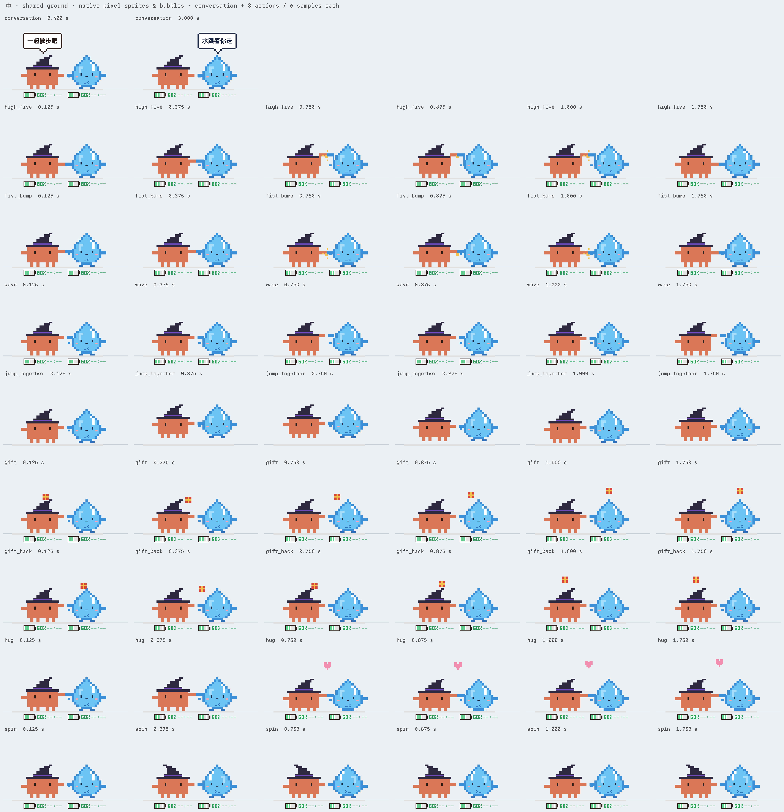

# 像素桌宠：小橘 & 小水滴

两只住在 macOS 桌面底部的像素风桌宠，会跟着 AI 编程助手的工作状态一起动：

- **小橘**（`desk-pet/`）：橘色像素小怪兽，跟着 Claude Code 的状态变化（思考、干活、完成、报错、睡觉）。
- **小水滴**（`codex-pet/`）：肚子上印着 `>_` 的蓝色水滴，读取 Codex 的会话日志，跟着 Codex 的状态变化。
- **侧边栏小橘**（`claude-panel/`）：一个 Claude Code 插件，在聊天窗口旁边显示同一只小橘，并把状态写给桌面上的小橘。

全部用 Swift + AppKit 一格一格画出来，不用任何图片素材。动画只能整格跳变、水平镜像或转 90°，没有淡入淡出和缩放。



## 它们会做什么

**自己的状态**
- 6 种心情、24 个通用动作；各有 8 套装扮，每套还有专属动作（右键「换装」）。
- 脚下有一块彩色额度牌：电池格数加剩余百分比，再加 5 小时额度的重置时间。绿、黄、红三色，一眼就能看出还剩多少。
- 拎起来从高处放手时会用不同方式保护自己，比如降落伞、气球、弹床、喷气背包，小水滴还会摔成一滩水再聚回来。

**两只之间**
- 走近了会见面聊天，按当时的情况选话题，比如谁在忙、谁额度低、是不是深夜，最后一起击掌、拥抱或转圈。
- 一方任务完成，另一只跑来击掌庆祝；一方报错，另一只过来拍拍它、递饼干。
- 一方干活超过 1 分钟，另一只坐到旁边举「GO!」牌子；一方额度低，另一只递电池；额度重置时一起放烟花。
- 闲着时随机踢小球、石头剪刀布、捉迷藏；很久没人理就靠在一起打盹。

**跟你**
- 鼠标靠近时眼睛跟着转；鼠标停在身上 2 秒，它会抬头看你。
- 单击：打招呼、做个小特技。双击：喂零食（小橘吃小鱼干，小水滴喝一滴水），每分钟最多 3 次。
- 拖起来朝另一只甩过去：70% 被接住，30% 撞个满怀冒星星。
- 早上第一次见你会伸懒腰；过了半夜 12 点，每半小时举牌提醒你睡觉。

**省电**：只有被拖动或下落时用 60 帧，走路和互动用 20 帧，站着用 10 帧，睡觉用 4 帧。只重画画面里变了的那一块，计算结果尽量缓存；闲着时每只占 CPU 约 3～5%。

## 安装

需要 Apple Silicon 的 Mac，以及 Xcode 命令行工具（提供 `swiftc`，Swift 6 或更新）：

```bash
xcode-select --install
```

然后在仓库目录里运行：

```bash
./install.sh
```

它会编译两个 App，把默认台词复制到 `~/.claude/pet/`（已有的台词文件不会覆盖），最后启动两只桌宠。

也可以分开编译：

```bash
cd desk-pet && ./build.sh && open DeskPet.app
```

```bash
cd codex-pet && ./build.sh && open CodexPet.app
```

退出：右键宠物选「退出」，或运行 `pkill -x DeskPet; pkill -x CodexPet`。

### 让小橘跟着 Claude Code 动（可选）

小橘读取 `~/.claude/pet/state.json` 里的状态。这个文件由 `claude-panel/` 里的 Claude Code 插件写入：

1. 把 `claude-panel` 复制到 `~/.claude/mods/slime-pet`；
2. 在 `~/.claude/settings.json` 里加上：`"env": {"CLAUDE_CODE_PLUGIN_DIRS": "<你的主目录>/.claude/mods/slime-pet"}`；
3. 重开 Claude Code，侧边栏会出现小橘面板，桌面上的小橘也会开始跟着动。

不装插件也能玩：小橘照样散步、换装、和小水滴互动，只是不会显示 Claude 的工作状态。

### 让小水滴跟着 Codex 动

不用额外设置。小水滴会读取 `~/.codex/sessions/` 里的 Codex 会话日志，从中得到工作状态和额度。

## 台词

台词都在 `~/.claude/pet/` 下的 JSON 文件里，改完会自动重新读取，不用重启：

| 文件 | 内容 |
|---|---|
| `lines.json` / `codex-lines.json` | 两只各自在不同心情下说的话 |
| `meet-lines.json` | 见面时 8 种情况的对话 |
| `landing-lines.json` | 落地特技的起跳和落地台词 |
| `play-lines.json` | 庆祝、安慰、踢球、喂零食、接住、早晚提醒等互动台词 |

仓库里的 `lines/` 是默认版本。

## 调试：马上触发某个互动

互动平时都有冷却时间。想马上看到效果，可以用下面这些命令（两只都要开着）：

```bash
defaults write local.deskpet.app forceInteraction celebrate
```

可选：`celebrate`、`comfort`、`cheer`、`give_battery`、`fireworks`、`soccer`、`rps`、`hide_seek`、`nap`。也可以按住 Option 右键小橘，从「互动测试」菜单里选。

```bash
defaults write local.deskpet.app forceUserPlay eat
```

可选：`eat`、`catch`、`morning`、`late`、`mouse`。把 `local.deskpet.app` 换成 `local.codexpet.app`，就是让小水滴来做。

## 检查

每个 App 都有一套离屏检查。它们不会启动 App，也不会改你真实的配置。检查范围包括像素规则（整格、不透明、无旋转缩放）、各种互动的触发和冷却、两只之间的站位不重叠，以及台词顺序：

```bash
cd desk-pet && ./check.sh
```

```bash
cd codex-pet && ./check.sh
```

小水滴的检查里包括一项上亿条断言的站位几何检查，要跑好几分钟。

## 目录

```
desk-pet/       小橘（DeskPet.app）
codex-pet/      小水滴（CodexPet.app），以及两只共用的代码：
                PixelDrawing 像素绘图 / Meeting 见面 / Play 互动 / Landing 落地 / UserPlay 和你的互动
                desk-pet 里的同名文件是指向这里的符号链接
claude-panel/   Claude Code 侧边栏插件
lines/          默认台词
docs/           预览图和设计草图
```
